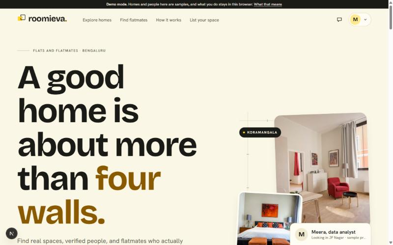
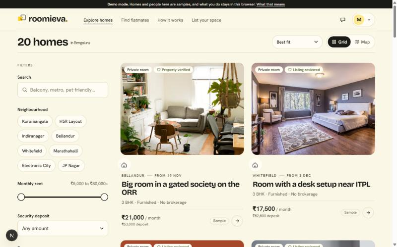
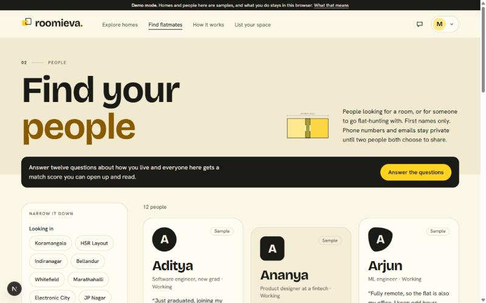

<div align="center">


# Roomieva

**Find a place. Find your people.**

A flat and flatmate finder that matches people on how they actually live,<br />
not just on rent and location. Starting with Bengaluru.


<br />



</div>

<br />

## Why Roomieva

A lovely room with the wrong flatmate is still the wrong home. Most listing sites stop at rent, deposit and photos. Roomieva also compares how two people live (sleep, cleanliness, food, guests, noise) and shows where they line up and where they'd need to talk, before anyone signs anything.

## Features

| | |
|---|---|
| **Lifestyle matching** | Twelve short questions, each marked flexible, important or non-negotiable. Every person and home gets a score you can open up and read. |
| **Explore homes** | Grid and map views, with filters for neighbourhood, rent, deposit, room type, furnishing, move-in date, amenities and match score. |
| **Find flatmates** | Browse people who are looking, best matches first. First names only. |
| **List your space** | An eight-step wizard with photo upload, drafts, and a private address that is never shown publicly. |
| **Request-first messaging** | A first message is a request. Chat opens only once it's accepted, with live updates and a typing indicator. |
| **Mutual contact sharing** | Phone and email stay hidden until both people agree to swap, and either can withdraw. |
| **Honest verification** | Each badge means one specific check, and the app says what it does not prove. |
| **Fresh listings** | Listings not reconfirmed within 21 days drop out of search until the lister confirms. |
| **Safety tools** | Block, report, automatic duplicate detection, and a moderation queue with a decision log. |

<div align="center">


</div>

## Tech stack

- **Framework:** Next.js 16 (App Router) with React 19 and TypeScript
- **Styling:** Tailwind CSS 4, Bricolage Grotesque and Hanken Grotesk
- **UI:** Radix UI primitives, Motion for animation
- **Forms and validation:** React Hook Form with Zod
- **Maps:** MapLibre GL with OpenFreeMap tiles
- **Backend:** Supabase (Postgres, Auth, Realtime, Storage) with row-level security
- **Tests:** Vitest

## Getting started

You need Node.js 20 or newer.

```bash
git clone <your-repo-url>
cd roomieva
npm install
npm run dev
```

Open [http://localhost:3000](http://localhost:3000).

### Demo mode

With no configuration, Roomieva runs in **demo mode**. Sample homes and people are seeded into your browser, sign-in codes are shown on screen instead of being emailed, and nothing leaves your device. You can also pick a ready-made sample account from the sign-in page to see the app from the inside.

### Connecting Supabase

To run with real accounts, a shared database and realtime messaging:

1. Create a Supabase project.
2. Run the SQL in [`supabase/migrations`](supabase/migrations) against it. This creates the tables, row-level security policies, functions, the photo storage bucket, and enables realtime for messages.
3. Create a `.env.local` file in the project root:

   ```bash
   NEXT_PUBLIC_SUPABASE_URL=https://your-project.supabase.co
   NEXT_PUBLIC_SUPABASE_ANON_KEY=your-anon-key
   ```

4. In Supabase Auth, add `{{ .Token }}` to the email template so the six-digit code is sent, and add your site's `/auth` URL to the allowed redirect URLs.
5. Restart the dev server. The app switches to Supabase automatically when both variables are present.

An optional `NEXT_PUBLIC_MAP_STYLE_URL` overrides the default map style.

## Scripts

| Command | What it does |
|---|---|
| `npm run dev` | Start the development server |
| `npm run build` | Create a production build |
| `npm run start` | Serve the production build |
| `npm run lint` | Run ESLint |
| `npm test` | Run the unit tests |

## Project structure

```
src/
  app/            Routes: landing, explore, homes, flatmates, messages,
                  list, my-listings, dashboard, saved, profile, quiz,
                  onboarding, auth, admin, safety, privacy
  components/     Shared UI, listing cards, map, compatibility orbit, site chrome
  lib/
    data/         Data layer: one interface, two implementations
                  (local.ts for demo mode, supabase.ts for production)
    demo/         Seed data for demo mode
    matching.ts   Compatibility scoring engine (with tests)
    filters.ts    Search and sort logic
    validation.ts Zod schemas
supabase/
  migrations/     Database schema, security policies and functions
```

## How matching works

Each lifestyle question places a person on a short spectrum. For two people, Roomieva measures the distance on every question both have answered and weights it by how much each person said it matters. A clash on something either person marked non-negotiable is always shown and caps the score. Scores are a preference estimate, not a promise.

## Status

Roomieva is an early build.

- Demo mode is exercised end to end: sign-in, onboarding, the lifestyle quiz, search, publishing a listing, reporting and moderation.
- The Supabase data layer and schema are written but have not yet been run against a live project, so expect some fixes on first connection.
- Phone verification, email or push notifications, and self-serve account deletion are not built yet.
- The contact address shown in the app is a placeholder.

## Safety note

Roomieva introduces people. It never handles payments, deposits or fees. Always visit a home and meet the people before paying anything.
